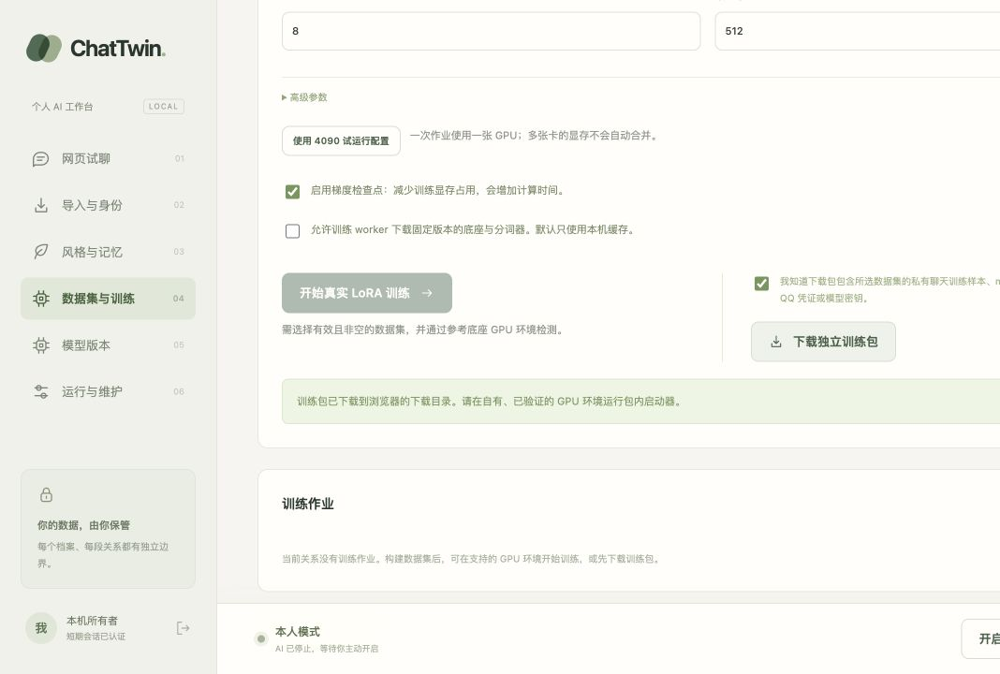

# 4090 与 QQ 接入准备 — 2026-10-26

本批推进 T02/T03/T21/T23；没有增加“真实 QQ / 正式 Qwen 已通过”的声明。用户可提供两张 4090，但连接和实际环境尚缺；先不租服务器。

## 已实现

- 单卡 `rtx4090-dry-run`：BF16、512 tokens、batch 1、累积 4、rank 8、最多 2 steps / 2 epochs。
- 真正非重入梯度检查点进入 TrainingSpec、API、网页和可移植训练包；不是训练模拟开关。
- CLI `train doctor` 与网页预检读取每张可见 GPU 的独立显存、CUDA runtime、计算能力和当前用卡；不相加或宣称已支持多卡。
- 训练报告记录分配/保留显存峰值；失败保存可读峰值及硬件报告。新进程加载前释放 loss/tensors/scaler 和模型引用并 GC，避免保留训练图增加显存压力。
- CLI 训练/推理和管理作业统一使用 `CHATTWIN_TRAINING_PYTHON`，保留 `CUDA_VISIBLE_DEVICES`；不向 worker 传 QQ/管理凭证。
- `scripts/prepare_gpu_smoke.py` 用包内虚构对话创建冻结 Qwen 数据集与 2 步 spec。新目录要求、Git 外输出；不会扫描 `chat_record` 或启动训练。
- 已核查 QCE v6.3.2 Mac 发布包和 NapCat 正向 WS 配置，记录桌面登录冲突、专用 QQ 副本/数据共用、许可及微信备份限制，未安装或扫码。

## 验证

| 边界 | 结果和证据 |
|---|---|
| 核心回归 | `uv run pytest -q`：129 passed / 1 skipped；skip 为核心环境未装可选 torch |
| 真训练/硬件契约 | training 环境运行 training_contracts、training_runtime、training_hardware：16 passed；含真实 tiny 梯度检查点训练，权重/loss 与原路径在 1e-6 容差内一致，保存并新进程重载产生非零 logits 差 |
| 静态检查 | Ruff check/format通过（81文件），mypy通过（60源文件） |
| Web生产构建 | 42 modules；JS 280.70 kB / gzip 87.01 kB，TS与生成schema通过 |
| 硬件预检 | 实际 Mac 返回 Darwin、CUDA false、devices=[]、CUDA_UNAVAILABLE / REFERENCE_HOST_UNVERIFIED；未伪造4090可用 |
| 虚构Qwen准备 | 仓库外生成2个train样本、0 validation/test、prepared spec；training_started=false，hardware=UNVERIFIED；小样本只供执行验证 |
| UI→API→下载包 | 真实浏览器选择4090预设：2步/512/梯度检查点；无CUDA时训练按钮禁用，允许下载独立包。下载文件实际检查configuration与所有bundle文件SHA-256，包含新参数；credentials/weights为false |
| 浏览器/服务 | loopback 8767应用启动成功；浏览器warning/error日志为空。仅合成测试关系，AI保持本人模式 |

仍有 Starlette/httpx TestClient 弃用提示；测试通过不隐藏该提示。逐卡显存测试里的两卡对象是明确契约 fixture，不是物理GPU证据。

## 剩余输入与下一批

待用户提供 GPU 主机系统/SSH 连接与现有聊天文件来源；密钥留本机。接入后先用虚构数据真实运行固定 Qwen，再记录显存、重载、认证部署及所需序列长度。之后进入足量确认数据和独立人工 B0–B3 质量评测。

QQ 仍需要适用许可的实际桥与本人登录；先只读探针，然后按既有用户自行发送偏好完成选定原私聊通知/接管。QCE实际导出兼容、手机网络/休眠、私人权重恢复、≥7天试运行仍未验证。代码和公开说明可推送，聊天、下载训练包和产物继续留在仓库外。
