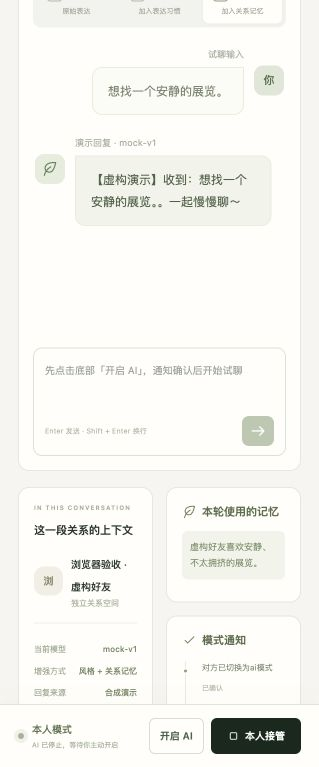

# 首轮实施与验证记录

日期：2026-10-26，用户时区 America/Los_Angeles。提交是本地开发版，未 push、未创建 release、未对外发送 QQ 消息、未上传聊天或私人模型。

## 里程碑结果

| 阶段 | 已实现/验证 | 剩余限制 | 下一批 |
|---|---|---|---|
| M0 | ADR、Mac/QQ/桥探针、许可来源、固定Qwen/tokenizer/template | QQ桥不存在；CUDA环境未提供 | 版本明确的实际导出、用户独立配置桥 |
| M1 | Python/React工程、首版迁移、领域schema/OpenAPI/TS、鉴权、虚构闭环 | schema为首版子集；远程CI未执行 | 继续补充模型部署/训练作业契约 |
| M2 | ChatLab/CSV/JSONL、身份/关系、数据集、风格草稿、记忆、网页试聊 | QCE无样本；画像编辑/全面映射/实际HTTP供应商兼容待补 | 训练jobs与模型注册UI前置整合 |
| M3 | 持久模式通知、唯一outbox、传输起点屏障、真实WS客户端、移动接管布局 | QQ实机与echo核对未验收，无v0.2发布 | 固定真实桥组合与指定会话故障验收 |
| M4 | 独立真实LoRA worker、mask、取消/中断、manifest、重载/认证推理 | tiny仅链路证据；正式Qwen/B0–B3与切换回滚缺失 | GPU dry-run、质量评测、作业与部署管理 |
| M5 | 本地安装/打包、数据目录保护、一致备份与空目录安全恢复 | 手机离网、完整删除传播、权重/代码回滚未完成 | 补齐运维管理并开展新环境验收 |
| M6 | 独立代码审查和6项专门竞态回归、许可/贡献/隐私基础 | 无100场景人工评分、7日实机或SBOM | 满足前置后再做发布候选审查 |

## 可复现工程证据

- `uv run pytest -q`：**59 passed, 1 skipped**。核心环境按设计跳过需要 torch 的训练运行时模块；该模块在独立训练环境另行真实执行。
- `uv run --project training --locked pytest -q tests/test_training_contracts.py tests/test_training_runtime.py`：**12 passed**（5.17秒）。两组有少量共享契约，不把数字相加作为独立案例数量。
- `uv run ruff check src tests scripts`：通过。
- `uv run ruff format --check src tests scripts`：41个文件格式通过。
- `uv run mypy src/chattwin`：31个源码文件无错误。
- `sh scripts/build_web.sh`：生成OpenAPI/TypeScript、TS严格检查及Vite生产构建通过。
- `uv build`：sdist/wheel构建通过；wheel包含静态网页、合成fixture和迁移。
- 从wheel以 `uv run --isolated --no-project --python 3.12 --with <wheel>` 安装：确认代码来自site-packages，网页GET200、未鉴权API401、鉴权加载demo200，CLI demo成功。
- Starlette/httpx TestClient发出一条弃用警告，尚未失败；不掩盖为无警告。

CLI demo 实际输出顺序：

```text
对方已切换为ai模式
【虚构演示】收到：周末一起去看展吗？。一起慢慢聊～
本人已接管
final_mode: HUMAN
```

覆盖的重要风险：未知发送不重发、慢开启回执期间接管、认领后发起前接管、旧页面仍可接管、接管后迟到模型失败不覆盖模式、真实账号跨数据目录唯一发送锁、不可变绑定和跨档案拒绝、上下文更新不取消通知、重启暂停、取消导入请求不提前释放数据版本屏障、恢复未知发送及关系隔离。

## 真实本地训练证据（仅 tiny）

随机初始化tiny Qwen3，224个可训练LoRA参数，8次optimizer steps；loss 3.0407379→2.7997925；最大参数变化0.1608262。训练进程PID79084与重载进程PID79089不同；基座/adapter最大logit差0.4429532。训练产物在系统私有临时目录，不在仓库；这里只记录汇总。

固定Qwen tokenizer实测51 tokens，其中43个上下文tokens屏蔽、8个当前目标tokens参与loss。没有下载正式4B权重，也没有作出聊天质量或风格提升结论。详细版本、命令和边界见 [training.md](../training.md)。

## 浏览器实际交互

真实本地浏览器/API/SQLite闭环，未用UI假数据替代API：

1. 登录隔离测试实例，加载虚构数据。
2. 开启后页面显示“对方已切换为ai模式 已确认”，状态AI模式。
3. 输入虚构问题，页面显示来自mock-v1的演示回复。
4. 本人接管后页面显示“本人已接管 已确认”，底部固定控件显示AI已停止。
5. 新建另一个虚构档案和关系，选择实际合成ChatLab文件，预览4条、明确选择demo_owner、勾选human确认、导入4条、2个候选训练目标。
6. 从真实导入消息选择出处，保存1条关系记忆；切换回原关系后记忆计数为0，没有跨关系混入。
7. 浏览器console错误记录为空。截图窄屏布局可看到两条通知和固定接管按钮；这不是实际手机离网验证。



浏览器演示实例使用独立临时目录及仅用于合成数据的测试凭证；它不是个人数据实例。常规启动使用默认私有目录并自动生成独立owner token。

## 数据性能与真实输入边界

100,000条合成CSV、8,377,832字节：预览0.796秒、导入16.351秒、进程峰值RSS 87,654,400字节，全部100,000条插入。单次本机测量，不承诺其他硬件的固定性能。

用户提供的chat_record：仅检查文件容器元数据，8个无扩展名文件、146,747,392字节，格式未识别。没有将正文、账号ID、姓名或私密模型复制到代码/日志/开发上下文。它们不能作为当前QCE/ChatLab兼容已通过的证据。

## 继续实施所需输入

- 一份版本明确、可解析的QQ/微信导出；现有容器需用户先用合适工具导出为支持格式。
- 用户自行选择并配置的QQ桥、稳定账号及唯一实测好友ID；当前偏好仍是本人发送外部消息，助手未实施真实发送。
- 用户选择的Linux/CUDA训练环境及可使用的确认数据；不自动租卡。
- 后续人工B0–B3评分、手机离网接管和至少7天实际试运行。

尚未实现的内部功能不伪装成外部阻塞，已在 [tasks.md](../tasks.md) 标PARTIAL/TODO：画像确认编辑、完整jobs/训练UI、模型注册切换回滚、来源删除传播、成熟预算诊断与发布SBOM等。
