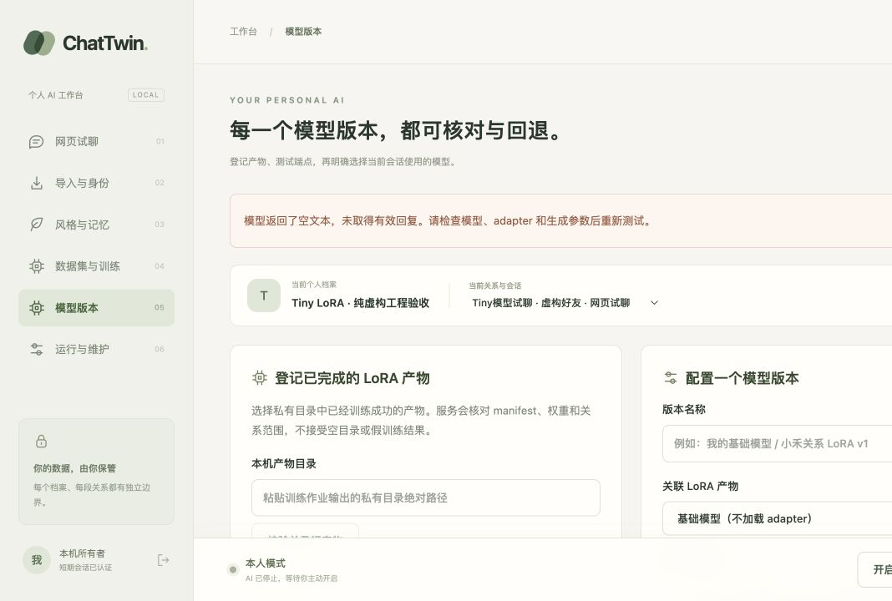

# 模型网页与短上下文推理增量 — 2026-10-27

目标链：真实训练并重载的产物 → 网页登记 → 认证模型身份/文本测试 → 明确启用 → 试聊/接管。本批只完成前两项和失败拒绝路径；通用文本连接测试未通过，未执行启用和后续试聊。没有以协议 stub、单条训练提示输出或数据库改状态替代验收。

## 实际训练与网页证据

数据是本批在仓库外人工创建的英文虚构 CSV。DataService 明确 private 与本人 human，冻结后 4 train / 1 validation / 1 test。它们只是 tiny 工程样例，数量不足以评价个人聊天质量。公开报告不包含真实聊天或凭证，完整产物留在本机私有目录。

| 步骤 | 结果 |
|---|---|
| 8 步 tiny CPU LoRA | 真实反向传播，最大参数变化 0.1518625；训练 PID 5650、重载 PID 5659；logits 最大差 0.2567748 |
| 网页登记 | manifest、权重摘要、来源数据集和 persona/relationship 校验通过；登记到当前虚构关系 |
| 认证连接 | `/health` 身份校验通过；固定虚构提示返回 HTTP 200，但解码文本为空，不能启用 |
| 独立新作业 | rank 8 / alpha 16、64 epochs 上限、128 optimizer steps；最大参数变化 0.9274794；训练 PID 6414、重载 PID 6469；logits 最大差 0.6854962；训练提示输出 `hi friend` |
| 新产物登记/探针 | 网页登记成功；固定连接提示仍为空，继续拒绝。训练提示成功不代表其他输入可用 |
| 短输入的实际HTTP复测 | 请求 `hello friend`、输出上限256，返回200及 `hi friend`；5输入+3输出=8 tokens，finish_reason=stop，未拒绝或截断输入 |
| 停止状态 | 没有启用这两个部署；数据库中两个均为unverified，7个会话均HUMAN，网页“启用此版本”禁用 |

另一个实验作业曾使用超界的 epochs 值，被新进程的规格验证拒绝；保留失败记录，未登记为成功。上述 128 步成功作业使用新目录、合法规格和当前训练源码 hash。

## 修复

1. 短序列部署原先把 `输入长度 + 请求回复上限` 作为拒绝条件，实际短输入也可能因通用客户端的输出上限收到 413。本批用真实本地服务复现。现在完整保留输入，将 `max_new_tokens` 限制在剩余的已验证序列预算；输入已占满预算仍返回 413，达到生成上限时报告 `finish_reason=length`。
2. HTTP 模型返回空白文本时给出 `MODEL_EMPTY_RESPONSE` 和明确诊断，避免将 HTTP 200 当作有效连接。空 choices 数组也被收敛为受控错误，不产生未处理 IndexError。未通过探针的版本继续不能启用。
3. 网页产物和关联部署显示 `CPU tiny：仅验证执行链，未验证聊天质量`；其他训练产物也明确连接成功不代表质量评测通过。

## 验证与边界

- 独立 training 环境：17 passed。包括真实 tiny LoRA、不同进程重载、认证/范围隔离、超大输出上限在完整输入后按预算生成、超长输入仍拒绝。
- 核心模型登记/运行/预算相关：18 passed。空文本、纯空白和空 choices 三种响应不能完成部署验证或启用。
- 核心全量：143 passed / 1 skipped，跳过的是核心环境未安装torch的可选训练测试模块；真实训练在上述独立环境执行。
- Ruff check/format 85文件、mypy 61 个源文件和生产构建通过；42 modules，JS 281.37kB / gzip 87.28kB。
- 浏览器显示新的空文本诊断、tiny 证据说明和禁用按钮；控制台 error/warn 为空。它证明真实后端错误在 UI 中正确呈现，不是完整模型试聊成功证据。
- 仍有 Starlette TestClient/httpx 弃用提示。没有真实 QQ 连接或发送，没有 Qwen/CUDA、人工质量或手机恢复验证。

下一步：GPU 到位后使用实际预训练 Qwen 重做文本探针、启用与试聊/接管；保持虚构数据先验收。手机旧记录通过独立导出路径确认后，再进行身份确认和足量数据的质量评测。
