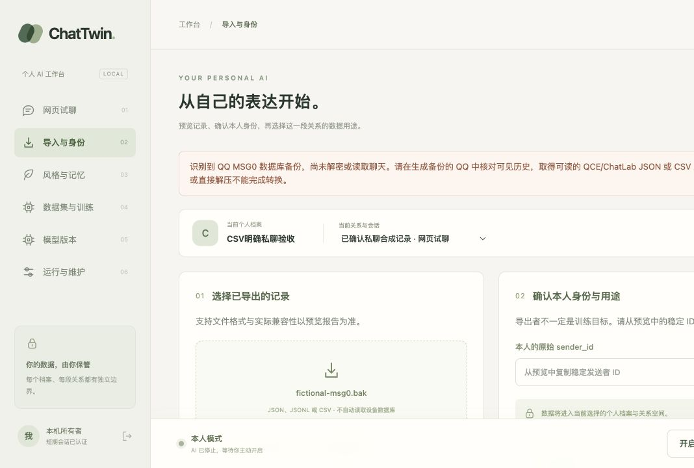

# QQ .bak 格式检查与导入诊断 — 2026-10-27

本批完成的是**真实用户文件的只读结构核验**和**导入失败的正确处理**。尚未解密、解析或导入这份备份的聊天内容，不计作真实 QCE 导出或模型训练验收。

## 真实本地文件的证据

用户明确提供本机 `.bak` 路径，并确认来源为“电脑 QQ → 导出聊天记录”。只在本机读取，未复制到仓库、浏览器、GPU 或远端。文件名、账号、内部成员名和源文件哈希不写入本报告。

| 检查 | 实际结果 |
|---|---|
| 外层文件大小 | 17,388,206 bytes，约 16.6 MiB |
| 容器 | ZIP，4 个普通文件，无 ZIP 层加密 |
| 内部格式 | 4/4 有 `SQLite header 3\0` 和偏移 32 的 `MSG0` 标记 |
| 页面结构线索 | 4/4 文件大小对 4096 取模为 1024；不是标准 SQLite 魔数 |
| 与 NTQQ 的区别 | 4/4 没有偏移 32 的 `QQ_NT DB` 标记；不能套用 NTQQ 方法 |
| 归档完整性 | 单独逐成员完整读取，ZIP CRC 全部通过 |
| 原件保留 | 检查前后 SHA-256 相同，没有修改或解包 |
| 正文、身份、时间范围 | 未解密，未知 |

归档 CRC 通过只说明 ZIP 成员与归档校验一致，不证明数据库解密有效、消息完整或手机旧历史都在其中。四个文件也不等于四个聊天对象。

原 `chat_record` 的 8 个文件进一步检查为 4 个 MSG0、4 个未识别文件；本 `.bak` 的 4 个成员与原 8 个文件的完整内容哈希均不相同。不能把文件数量和大小当成重复数据或历史范围的结论。

MSG0 的独立格式资料和 PCQQ 上游说明均区分普通 SQLite 与自定义数据库；PCQQ 文档已标为不再维护，旧提取脚本依赖运行中的 Windows 客户端及 key。本批没有运行上游注入/rekey 脚本、安装旧 QQ、恢复覆盖用户数据库或尝试 NTQQ 密钥推导。

- [PCQQ 上游说明，固定源码](https://github.com/QQBackup/QQDecrypt/blob/0dba968ebcb9ba23a68571780eb6b53687f77493/docs/decrypt/extract/PCQQ%20%28Windows%29.md)
- [旧版提取脚本，固定源码](https://github.com/QQBackup/qq-win-db-key/blob/5c643c39bdc65a7ce3ecc414052fdfd93d5f9107/scripts/windows/pcqq/pcqq_dump.py)
- [MSG0 / NTQQ 格式差异的独立调查](https://github.com/DaizeDong/qq-history-recovery/blob/1504fc4f39f369f54b88ffa96fc6cf46fadbe9ba/docs/JOURNEY.md)；仅用于格式交叉核对，其中的历史完整性推断不套用于本用户。

## 已实现功能

`chattwin import probe FILE` 在不创建 Store 的情况下检查不超过 64 MiB 的普通文件。输出只有文件大小、类型、成员类型计数和未解析标记；不输出文件名、路径、成员名、账号、密钥、原始字节或消息预览。

ZIP 检查先限制中心目录（256 KiB、128 条目），拒绝多卷、带 ZIP64 总目录记录、路径穿越、符号链接及不符合布局的容器；总声明解压大小不超过 512 MiB，单成员压缩比不超过 100。仅读取每个允许成员最多 1024 字节，不提取、不递归归档、不取联网附件。它不做完整 CRC，输出明确 `full_crc_verified=false`；上面的 CRC 证据来自本次独立完整读取。

导入器在自动检测或显式指定 QCE/ChatLab/CSV/规范 JSONL 时都先识别容器。MSG0 返回 422 `QQ_BACKUP_REQUIRES_CONVERSION`，普通数据库、未知归档和二进制输入有不同说明。修复了自动检测在 UTF-8 解码阶段漏出的异常；上传临时文件在失败后清理，不能通过改扩展名或选择其他格式绕过。网页允许选择 `.bak` 以获得诊断，并明确标注尚不能解密导入。

Git 忽略 `.bak`，发布检查同时拒绝 `.bak` 扩展名及无扩展名的标准/自定义 SQLite 文件头。它仍不是任意私人数据检测器，推送前需审查具体暂存内容。

## 验证

- `uv run pytest -q tests/test_import_probe.py`：21 passed。测试全部临时生成虚构字节，包含类型区分、改后缀/显式格式、损坏/路径穿越/符号链接/加密/膨胀归档、UTF-8 边界、API 422 与上传清理、CLI 不创建数据库且不泄露路径。
- `uv run pytest -q`：164 passed、1 skipped。跳过项仍为核心环境的可选 PyTorch runtime；本批没有更改或重新验收训练后端。
- Ruff lint 与 format（87 文件）、mypy（62 源文件）通过。
- `sh scripts/build_web.sh`：TS 类型检查、OpenAPI 生成与 42 模块 Vite 生产构建通过；JS 281.48 kB / gzip 87.32 kB。无 API schema 字段变化。
- 本地浏览器：短期会话登录 → 导入与身份 → 选择临时生成的虚构 MSG0 `.bak` → 预览 → 显示明确诊断，身份导入按钮保持禁用。没有把用户真实备份上传到网页；控制台 error/warn 为空。

## 剩余限制与下一步

生成备份的 QQ 版本、电脑可见历史范围未确认。若电脑已能看到所需记录，优先按 [固定 QCE 步骤](../qq-setup-research.md) 导出单 JSON，再在本机核对真实格式、稳定身份、条数、时间和抽样。若只有近期记录，继续记录缺口；`.bak` 存在不能替代旧历史可用性证明。

真实 MSG0 转换、QCE 导出兼容、QQ 原私聊、正式 Qwen CUDA、人工质量评测和 7 天试运行均未因此完成。原件和本机私有核验报告保留，Git 只含代码、虚构测试与本脱敏报告。
