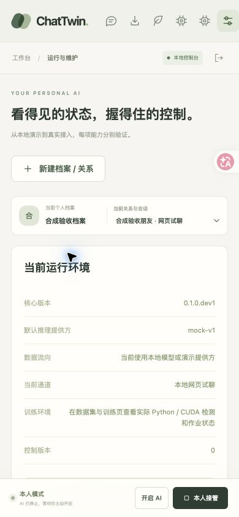

# 本地网页管理流程验收 · 2026-10-26

本次故事：本人登录获得短期会话，通过网页操作同源 API，将合成聊天导入独立 Persona/Relationship，确认风格与记忆，冻结训练数据，检查真实训练环境和作业，并完成预算、备份、删除传播和发送结果核对。

## 环境与边界

- 本地服务：`http://127.0.0.1:8767`；数据目录：`/tmp/chattwin-m2-review`；`CHATTWIN_REQUIRE_SESSION=1`。
- macOS/Darwin，Python 3.12.14，Chrome；默认桌面视口，另测 390 × 844 移动视口。
- 仅使用内置虚构 demo、`examples/generic_chat.synthetic.csv` 和明确标记的合成故障记录。未选择真实聊天、QQ 会话或私人模型，未向外网模型发送提示。
- 模型输出来自 `mock-v1`，均显示“虚构演示”。这些回复不是模型质量或 QQ 实机证据。
- 真实训练队列执行了环境预检，但 CUDA 不可用，未下载底座、未开始训练、没有成功产物。
- 未记录本人凭证或短期令牌。浏览器操作使用 CUA；SQLite 检查使用只读连接。

## 浏览器与数据证据

| 流程 | 实际操作与结果 |
| --- | --- |
| 短期会话 | 输入测试本人凭证后进入工作台，显示“短期会话已认证”。退出显示“短期会话已撤销”；重新登录后刷新仍可使用。服务重启后旧会话失效，需要重新登录。 |
| 凭证实现 | `App.tsx` 先 POST `/auth/session`，再以返回短期 token 读 `/state`；只将短期 token 写入 `chattwin.session.v1`。`main.tsx` 删除旧版 `chattwin.auth.v1`。这项存储行为以代码审查为证，未读取浏览器隐藏存储或输出令牌。 |
| 开启与接管 | 点击开启后，“对方已切换为ai模式”显示已确认，模式成为 AI_ACTIVE。B0/B1/B2 均显示实际档位和 `mock-v1` 回复；本人接管后显示 HUMAN，通知“本人已接管”已确认。 |
| 记忆 | 从当前关系的真实来源选择器选择合成对方消息，保存记忆，再编辑并重新确认。SQLite `memory_items` 为 version 2、confirmed true；B2 本轮使用的记忆显示编辑后的文本。 |
| 风格 | 编辑规则，保存草稿版本 1，再确认启用版本 2。SQLite 保留 draft v1 / approved v2，未将草稿冒称启用。 |
| 独立空间 | 网页依次创建 Persona、Relationship、HUMAN 网页 Binding，并自动进入新关系导入页。切换关系后表单和数据报告重新加载。 |
| 导入与身份 | 原生文件选择器选取合成 CSV，预览显示 4 条、0 错误和人类可读文本。按稳定 `demo_owner` ID 选择本人并确认真人来源；报告与身份表显示正确 owner/partner。JSON 详情默认折叠。会话类型保守规则的修正与复验见下节。 |
| 数据集 | 合成私聊快照显示训练 2、验证 0、测试 0，并明确提示独立片段不足，不能进行可信 held-out 评测。样本预览区分“历史上下文”和“当前本人目标”。 |
| 训练包 | 页面触发实际下载；Downloads 中存在 `chattwin-training-bf09f40a-9402-4891-b499-b10001a3acd0.zip`。`unzip -l` 检查到 20 个文件，含所选 train/validation/test、manifest、固定依赖锁、源码、启动器和 LICENSE。 |
| GPU 预检 | 页面显示 Darwin、Python/训练依赖可用、CUDA 不可用、`CUDA_UNAVAILABLE`、`REFERENCE_HOST_UNVERIFIED`；正式训练按钮保持禁用。 |
| 真实队列失败 | 因网页正确阻止无 GPU 提交，另用正常认证 HTTP 向已有 demo dataset 提交 max_steps=1、allow_model_download=false。作业 `2ffa9572-e189-45c9-b21f-d0c87c74ebbf` 实际经历 queued → validating → failed。页面显示 `preflight_failed`、`CUDA_UNAVAILABLE`、Step 0、0%、尚无 loss；事件为 queued/owner_requested、validating/environment_preflight、failed/CUDA_UNAVAILABLE。临时 API 会话随后撤销。 |
| 删除传播 | 预览列出 4 条消息、4 条用途映射、1 个数据集；明确勾选后删除测试批次。批次消失，原数据集显示“已失效”且选项禁用。SQLite 对应 dataset status=revoked。已有备份与权重不会自动遗忘的说明保留。 |
| 模型保护 | 不存在的私有目录登记被拒绝。保存 `http://127.0.0.1:9/v1` 本地不可用端点时只生成 unverified 配置；点击测试后明确失败，“启用此版本”始终禁用。未调用外网模型，也未伪造有效产物。 |
| 预算 | 输入单价只填一项时保存禁用；同时填双价和限额后保存版本 1：75 请求、输入 USD 1.25/百万、输出 USD 2.5/百万、金额上限 USD 5。切到 demo Persona 仍为默认 1000/版本 0。失败本地端点请求保留 1 次、214 输入、8 输出、未结算 1 次的预留，显示 USD 0.0003 估算。重启后策略和预留记录仍存在。 |
| 诊断与备份 | 页面外键检查通过；备份创建报告为 9 个被备份文件、约 0.25 MiB。下载 ZIP 实际存在，归档含 10 项（含归档自身清单），解压大小 263378 bytes。诊断 JSON 实际下载，privacy 的 chat_content_included/secrets_included/paths_included 均为 false。恢复仅展示离线 CLI，不覆盖运行目录。 |
| 移动端 | 390 × 844 下 document clientWidth=390、scrollWidth=390；6 个导航均有可访问名称，固定“本人接管”可见。测试后已恢复默认视口。 |
| 浏览器日志 | 在主线完成、模型负例和最终试聊后读取 console error/warn，结果为空。服务默认关闭 access log，因此不把不可见的 HTTP 状态码写成证据。 |

## CSV 默认类型问题及修正后复验

首次 CSV 流程没有显式选择会话类型，当时后端默认 private。该次成功只能证明初版流程连通，不能用作保守会话隔离规则通过的证据。随后后端改为默认 unknown，前端增加“原会话类型”：

- 默认“按文件声明；未声明为未知”，映射默认 `{}`，不注入 private。
- 只有明确选择一对一私聊才写入 `mapping.conversation_kind=private`；群聊选项写入 group。
- 新文件或格式会清空旧类型、映射和身份确认；自定义 JSON 与选择矛盾时拒绝继续。

重启最新后端并重新登录后，使用同一份合成 CSV、新来源账号和两个全新 Persona 复验：

| 新 Persona | 输入 | 结果 |
| --- | --- | --- |
| CSV类型未知验收 | 保持默认未知，仍明确选择 owner 并确认真人 | 导入 4 条，训练目标 0。构建数据集返回 `No scoped records are available`。只读 SQLite 显示这 4 条用途的 relationship_id 均为 NULL。 |
| CSV明确私聊验收 | 显式选择“我确认这批记录来自一对一私聊”，选择 owner 并确认真人 | 导入 4 条，训练目标 2；4 条用途属于指定关系。构建出训练 2/验证 0/测试 0 快照，网页通知确认后 B2 合成回复成功，最后本人接管回到 HUMAN。 |

## 未知发送核对：明确为合成故障注入

集成负责人仅在此测试数据库注入 outbox `a2d3041c-6e15-4c21-bb2d-be07a8072384`，文本明确为“【合成故障注入】这条消息没有向任何真实平台提交”，审计标记未调用真实传输。

网页只读渠道核对仍返回 unknown；重启中会话失效后重新登录，再次只读核对仍为 unknown。人工选“确认未送达”后平台消息 ID 输入禁用，填写的证据为“合成故障注入，已核对本地假通道，未发生任何真实平台提交”。勾选确认并保存后，列表清空，页面说明证据来源为人工核对、未重发、AI 保持停止。

只读 SQLite 确认：status=rejected；resolution.outcome=not_sent；source=owner_attested；platform_message_id=null；automatic_resend=false。审计保留两次 channel_reconcile unknown 和一次 owner_attested 结论。结束时四个 Binding 均为 HUMAN。此测试不是 QQ 平台送达或人工核对 QQ 的证据。

## 工具限制与未验证项

- Chrome 扩展文件上传接口缺少 file URL 权限。没有扩大扩展权限，改用原生文件选择器完成同一合成文件上传。
- CUA download 事件未捕获 blob 下载；通过 UI 成功反馈、Chrome 下载记录、实际文件和 ZIP 内容确认文件存在，没有把事件超时误判为下载失败。
- 未完成真实 QQ 原会话、移动网络/TLS 下手机接管、外部模型推理、参考底座 GPU 训练、有效 LoRA 产物部署/B3 成功或回滚成功验收。
- 正式训练因环境阻塞，浏览器未验证运行中作业取消。未用假训练或模拟成功产物补齐这些限制。
- 本次验证未进行离线备份恢复；恢复能力需使用对应独立测试证据。

## 构建与截图

`sh scripts/build_web.sh` 成功执行 schema 导出、冻结依赖安装、OpenAPI 类型生成、TypeScript 严格检查、Vite 构建和资产复制。最新构建为 42 modules，JS 279.53 kB / gzip 86.65 kB；`pnpm format:check` 和 `git diff --check -- apps/web` 通过。

截图仅含合成内容。浏览器原始 JPEG 通过 `sips` 无内容修改转成 PNG：

- [管理页](web-management.png)，1512 × 3154。
- [移动管理页](web-management-mobile.png)，390 × 844。
- [默认未知 CSV](web-csv-unknown.png)。
- [明确私聊 CSV](web-csv-private.png)。
- [合成未知发送人工核对](web-reconciliation-synthetic.png)。
- [真实训练预检失败与事件](web-training-preflight.png)。

