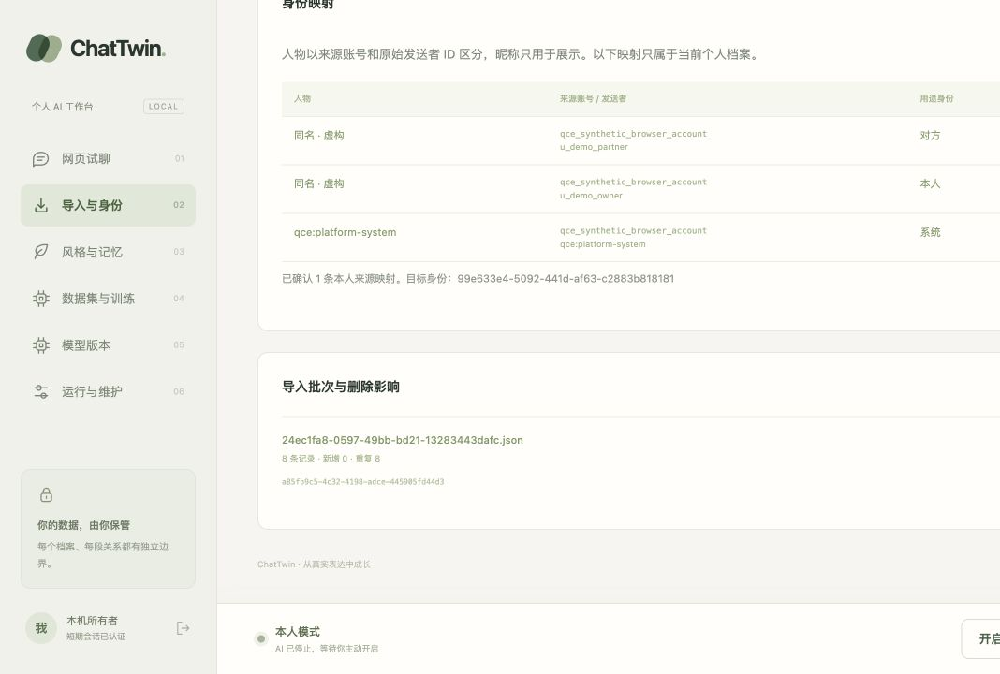

# QCE 单文件 JSON：实现与验收边界

当前已实现独立解析器、网页入口与合成数据闭环。**未运行 QCE 导出器、未使用真实聊天导出验证，不宣称已兼容用户当前备份或任意 QCE 版本。**

## 固定参考

按 QCE v6.3.2 的提交 `7d154b847a0cb3f9cffbdb126598c4d1434995ba` 阅读公开数据定义后独立实现，未复制、运行或捆绑其 GPL 实现。

| 事实 | 固定上游依据 |
|---|---|
| camelCase、毫秒时间、sender UID/UIN、content.elements、system/recalled | [types.rs](https://github.com/shuakami/qq-chat-exporter/blob/7d154b847a0cb3f9cffbdb126598c4d1434995ba/qq-chat-export-core/src/types.rs) |
| 顶层 metadata/chatInfo/statistics/messages；单 JSON 与分块 JSONL 是不同模式 | [json_exporter.rs](https://github.com/shuakami/qq-chat-exporter/blob/7d154b847a0cb3f9cffbdb126598c4d1434995ba/qq-chat-export-core/src/json_exporter.rs) |
| metadata.name=QQChatExporter；metadata.version 来自导出核心 crate，版本为 0.1.0 | [Cargo.toml](https://github.com/shuakami/qq-chat-exporter/blob/7d154b847a0cb3f9cffbdb126598c4d1434995ba/qq-chat-export-core/Cargo.toml)及上述types定义 |
| 正文元素 text/data.text，引用 referencedMessageId | [解析器](https://github.com/shuakami/qq-chat-exporter/blob/7d154b847a0cb3f9cffbdb126598c4d1434995ba/qq-chat-export-server/src/parser/simple_parser.rs) |
| statistics.totalMessages 为写出消息数量 | [stats.rs](https://github.com/shuakami/qq-chat-exporter/blob/7d154b847a0cb3f9cffbdb126598c4d1434995ba/qq-chat-export-core/src/stats.rs) |

`metadata.version=0.1.0` 无法证明用户使用的是 QCE v6.3.2。报告单独列出参考 release、schema 版本、`actual_release_verified=false` 和 `real_export_validated=false`；不要把参考版本写成实测版本。

## 当前行为

- `format=qce` 或自动识别；只接受上述 metadata 与 messages 数组，统计数需一致。其他版本、分块 manifest 拒绝，绝不按其中的 chunks 路径读取文件。
- sender_id 使用原始 UID；缺 UID 时保留原始 UIN，不按昵称或相同 UIN 自动合并不同 UID。selfUid 只作来源说明，Persona 本人仍需显式选择和 human 确认。
- private 关系使用 source account + peer UID/UIN 区分；无 peer 时需在映射 JSON 显式设置 `qce_conversation_id`。group/temp 不因用户选择 private 改写类型；缺稳定会话 ID 的非私聊按文件范围保存。
- 毫秒转 UTC；time 展示字符串不决定时区。秒误填毫秒、非字符串 ID、声明私聊之外的 sender、冲突引用报为坏行；错误摘要不泄露正文。
- 训练文本来自结构化 text 元素；引用预览不成为本人回复。HTML 字段、rawMessage、卡片和嵌套转发作者不解析执行或复制为训练正文。
- 系统、撤回、媒体/未知元素、两条固定模式通知不成为训练目标。媒体只留类型占位与原文件哈希/行号来源；不读本地附件路径、不访问 URL，不支持图片/语音理解。
- 系统行缺发送者时使用明确系统占位，不出现在本人候选中。导入与身份重映射将 platform_system 标为“系统”，排除通知/系统正文作为训练上下文。
- 原文件由用户持有，核心保存规范消息、原始 UID/UIN 和出处，不上传或将其加入 Git。

网页限制 20 MiB；CLI JSON 文件限制 64 MiB、单记录限制 1 MiB。较大导出可缩小时间范围、关闭嵌入头像后重新导出。系统角色修正不会暗中改写已有用途映射；历史冲突走显式身份重映射。

## 可复现验证

```sh
uv run chattwin import inspect examples/qce_v6_3_2.synthetic.json --format qce
uv run pytest -q tests/test_qce.py tests/test_data.py tests/test_data_management.py
```

fixture 完全虚构，按固定契约人工构造，**不是 QCE 实际导出证据**。8 条记录覆盖同名双方、文字/换行/字面 HTML、引用、媒体、撤回、无发送者系统通知、模式通知和未知元素。预览 8 条 / 0 错误 / 3 文字；本人确认后 2 条源消息可作目标，连续本人短句合并为 1 个训练窗口。0 验证/测试样本明确为低可信。

7 项 QCE 测试覆盖解析、BOM 跨文件去重、导出者与身份分离、群聊/临时会话隔离、坏行、版本/计数/分块路径拒绝、UIN 回退、peer 缺失；另加 1 项系统角色在导入及重映射后的回归。核心全量 137 passed / 1 skipped，Ruff 83文件、mypy 61源文件、生产构建通过（JS 281.05 kB / gzip 87.16 kB）。

浏览器实际上传→预览→选稳定UID→确认→导入→数据集预览通过，控制台 warning/error 为空。首次导入发现系统行误标“对方”，修复后新档案显示“系统”。同一原始合成文件在第二个 Persona 导入时显示重复8、新增0：共享来源去重，独立用途映射仍新增，不混用本人身份。所有会话保持 HUMAN。



下一步：按 [QCE 导出步骤](qq-setup-research.md) 取得明确版本导出，在本机核对时间、UID/UIN、类型、数量和历史边界。只把脱敏统计与结论写入证据，真实导出留私有目录。T09 保持 PARTIAL，真实导出验收仍待完成。
